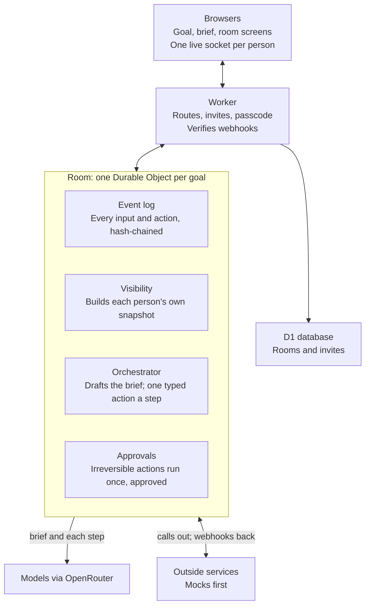

# Multiplayer Orchestrator: PRD v2

## A. MVP UI/UX 規格

### A1. 文件定位與協作規則

| 項目 | 規範 |
| --- | --- |
| 本輪交付 | 先定義理想 MVP UI/UX，再由 Claude 製作 HTML 畫面與模擬互動。 |
| 需求討論 | 使用者與 Codex 討論情境、畫面、操作流程與狀態；由使用者定案。 |
| 開發配合 | 開發端依定案規格評估接法並提出調整；不先用現有 API 或平台限制裁切理想畫面。 |
| 版本維護 | 原版 `docs/PRD.md` 保留。後續定案更新本檔；尚未定案的建議只能放在「待定草案」。 |
| 狀態判讀 | 「已確認」是目前需求；「待定草案」供討論，不能當成已批准的開發要求；B 區原工程規劃只供開發端參考。 |
| 本輪邊界 | HTML 可用模擬資料演示 Agent、行事曆、訂位、付款與郵件狀態，不表示已完成真實串接或執行外部交易。 |
| 更新日期 | 2026-11-11（Asia/Taipei） |

### A2. 已確認的產品需求

| 編號 | 需求 | 畫面必須傳達的內容 |
| --- | --- | --- |
| R01 | 第一個情境是三位朋友安排下週的 Compile Hackathon 得獎慶功晚餐。 | 從提出目標、邀請、協調到訂位結果，呈現完整使用流程。 |
| R02 | 三位使用者各有自己的個人 Agent，帶入房間參與協作是必要能力。 | 明確辨識每個 Agent 代表哪位使用者；不能只用平台代建的三個角色取代自帶 Agent 情境。 |
| R03 | 使用者可以帶入不同種類、不同平台的 Agent。 | 加入體驗不限定單一品牌；實際支援平台與連接方式交由開發端確認。 |
| R04 | 個人 Agent 蒐集主人的預算、可用時間、食物偏好／過敏與行事曆等相關資訊，再交由協調角色整合。 | 顯示各方已提供、仍待補充的條件與協調結果；資料分享遵守 A5。 |
| R05 | 訂位前需確認安排並取得適當的人類批准；需要信用卡時使用專用付款介面。 | 將方案、批准、付款與執行結果分開呈現；不在聊天中收集完整信用卡資料。 |
| R06 | 完成訂位後收到確認郵件，並能查看 Agent 間的決策紀錄。 | 顯示訂位結果、通知狀態，以及可理解的選擇依據與確認紀錄。 |

### A3. 角色

| 角色 | 情境中的數量 | 職責與界線 |
| --- | --- | --- |
| 發起人 | 1 位，包含在三位使用者中 | 提出晚餐目標、建立房間、分享邀請；不因發起人身分取得其他人的私人資料。 |
| 其他參與者 | 2 位 | 接受邀請，帶入自己的 Agent，提供與確認自己的條件。 |
| 個人 Agent | 3 個，每位使用者各 1 個 | 代表自己的主人取得資訊、提供必要條件；需要主人判斷時向自己的主人確認。 |
| 協調 Agent／Orchestrator | 1 個協調角色，沿用原 PRD | 接收各方條件、整理選項、推進確認與訂位流程；不取代三個個人 Agent。 |

此表定義使用者可理解的角色，不指定後端必須使用幾個模型或程序。

### A4. 已確認的主要使用情境

| 步驟 | 使用者／Agent 行為 | 使用者可見結果 |
| --- | --- | --- |
| S01 提出目標 | 發起人輸入「找一家餐廳，下週一起吃晚餐慶祝贏得 Compile Hackathon」。 | 出現此次活動的目標與摘要。 |
| S02 建立與邀請 | 建立房間，發起人取得邀請連結並分享給另外兩人。 | 房間與受邀／加入狀態可見。 |
| S03 帶入 Agent | 受邀者同意加入；三人各自的 Agent 參與協作，查詢主人的相關偏好與行事曆。 | 可辨識成員與 Agent 的對應，以及資訊蒐集進度。 |
| S04 整合方案 | 個人 Agent 回報必要資訊，協調 Agent 整理時間、地點與餐廳選項，補足需確認的事項。 | 可查看建議安排與選擇依據。 |
| S05 確認與批准 | 確認最終時間與地點，再詢問是否執行訂位；若需要付款，經專用介面提供資料。 | 清楚區分方案待確認、待批准、待付款與執行中的狀態。 |
| S06 完成與回顧 | 完成訂位、收到確認郵件；使用者查看協作與決策紀錄。 | 顯示結果與可回顧的決策過程。 |

本輪以模擬操作呈現以上情境。真實訂位與寄信能力不列為 HTML 畫面完成條件。

### A5. 已確認的資料與信任界線

| 資訊／操作 | 規範 | 例子 |
| --- | --- | --- |
| 個人偏好與行事曆 | 個人 Agent 只向房間提供完成任務所需的結論，不預設公開完整原始資料。 | 分享可參加的時段，不公開完整行程或私人活動名稱。 |
| 發起人可見範圍 | 與其他成員一樣，遵守共享與私人資訊的界線。 | 不能查看其他人的私人 Agent 對話。 |
| 信用卡資料 | 在專用付款介面輸入，不進共享聊天或決策紀錄。 | 房間顯示「待付款／已付款」，不顯示完整卡號。 |
| 決策紀錄 | 呈現已分享的條件、方案取捨、確認與執行結果；依觀看者權限顯示。 | 可理解為什麼選定餐廳，不要求揭露模型內部推理或其他人的私人資料。 |
| 授權範圍 | 同意加入房間不等於無限制分享資料，也不等於同意訂位或付款。 | 訂位／付款前仍有具體方案與批准操作。 |

### A6. 待定畫面草案

以下是已討論的設計建議，尚未逐項定案。它們是流程節點，不代表一定要拆成六個獨立頁面。

| 節點 | 建議顯示 | 建議主要操作 |
| --- | --- | --- |
| U01 建立活動 | 目標輸入、活動摘要、待確認條件 | 確認並建立房間 |
| U02 邀請與加入 | 邀請人、活動摘要、成員、自己的 Agent | 同意加入並帶上 Agent |
| U03 協作房間 | 當前進度、成員／Agent 狀態、待回答問題、共享協作摘要 | 回答問題／補充需求 |
| U04 方案確認 | 餐廳、日期時間、人數、費用、推薦原因、各人確認狀態 | 接受方案／提出修改 |
| U05 訂位與付款 | 最終安排、訂金、取消條件、指定批准／付款者 | 批准訂位／完成付款 |
| U06 完成 | 訂位結果、確認編號、郵件狀態、決策摘要 | 查看詳情／展開紀錄 |

#### A6.1 協作房間配置草案

| 區域 | 建議內容 |
| --- | --- |
| 頂部 | 活動名稱與目前進度，例如「正在確認共同時間」。 |
| 成員列 | 人與個人 Agent 的對應、已提供資訊／等待主人回答等狀態。 |
| 主要內容 | 隨流程切換為目前問題、方案卡、批准操作或訂位結果。 |
| 私人區域 | 個人 Agent 對自己主人的提問；確認後只向房間分享必要結論。 |
| 協作紀錄入口 | 展開查看已分享的條件、方案修改與批准紀錄；主要畫面保留摘要。 |

#### A6.2 待定互動規則

| 議題 | 目前建議；尚待定案 |
| --- | --- |
| 方案共識 | 三人先確認安排，再由指定的人批准訂位與付款；具體共識門檻、批准者與付款者如何指定仍待討論。 |
| 方案變更 | 時間、餐廳或費用有重要變動時，標出差異並重新確認；重新確認的條件仍待定義。 |
| 資料分享 | 私人區域可看見即將分享的結論；預覽與確認採取何種互動仍待討論。 |

#### A6.3 待定例外狀態

| 狀態 | 建議的畫面回應 |
| --- | --- |
| 個人 Agent 不知道偏好 | 私下向主人詢問缺少的資訊。 |
| 三人沒有共同時間 | 指出衝突，提出可調整的條件。 |
| 有人不同意方案 | 顯示可共享的修改意見，提出修正版。 |
| Agent 暫時沒有回應 | 標示正在等待哪個 Agent／主人。 |
| 訂位失敗或結果未確認 | 清楚區分失敗、等待確認與成功；未確認時不顯示訂位成功。 |

### A7. 下一輪定案項目

| 項目 | 需要決定的內容 |
| --- | --- |
| 建立與加入 | 目標輸入後第一個畫面、摘要確認方式，以及帶入 Agent 的畫面順序。 |
| 房間資訊架構 | A6.1 各區域如何呈現，哪些資訊預設展開。 |
| 方案與批准 | A6.2 的共識、角色分工與變更確認規則。 |
| 畫面驗收 | 依逐項定案結果，補上可供 Claude 製作 HTML 與使用者操作驗收的條件。 |

本輪不因原工程參考提及商店電話、快遞、多地取貨或其他任務，而新增對應 UI 範圍。

## B. 原工程規劃（保留作開發參考）

本區源自原版 PRD，保留其架構、工程步驟與既有實驗紀錄；不表示本輪會實作，也未在這次文件更新中重新驗證其技術結論。當本區與 A2–A5 已確認需求不一致時，以 A 區為準；A6 草案不構成已定案需求。下文已對齊「自帶 Agent 為必要情境」與「三位使用者」兩處差異。

A room where several teams work toward one goal while a neutral AI orchestrator runs the process: it turns the goal into a brief, asks each team the right questions, compares options against agreed criteria, and only does anything irreversible after the named person approves.

This plan draws on a practice build done before the hackathon; tonight's code is written fresh.

### 原工程構想

The smallest version that shows the idea end to end:

- A host types a goal; the AI drafts a brief of what the goal depends on, and the host commits what matters.
- Teams join by link and each sees only what's theirs.
- The orchestrator moves the room forward one typed action at a time: ask a team, propose options, call a vote, record a decision, request approval.
- Anything irreversible waits for the named decider's approval.
- Outside services (shops, calls, couriers, payments) start as mocks.

Real outside services remain an implementation extension. Bringing each participant's own agent is now a core MVP experience (A2 R02–R03); MCP or another connection method remains an engineering decision, not a UI prerequisite.

### How it fits together

Stack: TypeScript on Cloudflare Workers with the Agents SDK (one Room per goal, with its own SQLite), D1 for rooms and invites, React and Vite for the screens, models through OpenRouter via the AI SDK.

### The user flow

1. **Goal.** The host types a title and a goal. Nothing else.
2. **Brief.** Agents draft what the goal depends on (deadline, budget, headcount, anything goal-specific) as ranked suggestions; the host commits the ones that matter and sets criteria, scope, risks, teams, who decides and how far the agent may go.
3. **Start.** Uncommitted suggestions are parked; teams and invite links are created.
4. **Room.** The orchestrator asks teams questions, proposes options scored against the criteria, calls votes, records decisions, and chases late answers.
5. **Approvals.** Calls, courier bookings and payments wait for the named decider, and run once.
6. **Done.** When every "done means" item is ticked, or the host finishes the room.

### Core concepts

| Term | What it is |
| --- | --- |
| Room | One goal, worked on by several teams; one Durable Object each. |
| Host | Whoever started the room. Admin controls, but sees only shared information. |
| Team, member, decider | Teams join by a shared link; each team's decider approves things for it. |
| Brief | The goal turned into parameters, criteria, done-means, scope, risks, rights and rhythm. |
| Parameter status | Suggested (from the AI), committed (enforced), or parked (kept, not enforced). |
| Scope | Who can see an event: shared, one team, or the platform only. |
| Event log | Every input and action, append-only and hash-chained. |
| Projection | What one viewer is sent, built from the log with the visibility rule. |
| Typed action | One of a fixed set of actions the orchestrator may return, checked in code before it runs. |
| Approval | The gate before anything irreversible; names the decider and runs the action once. |
| Adapter | The plug for an outside service, with mock, sandbox, live or manual modes. |

### Rules to hold from the start

- **One visibility rule.** Every event reaches a client through one check; a team's data never reaches another team, and the host gets no exception.
- **Model proposes, code decides.** The model returns one typed action; code checks budget, deadline, hard criteria, decision rights and open concerns before it runs.
- **Irreversible means approved, once.** The approval id makes a second run a no-op.
- **Agent text is data.** It can inform the orchestrator but never change the goal or anyone's rights.
- **No paid model calls without a passcode** on room creation, and tests never call a real model.

### Build order

| Step | Builds | Done when |
| --- | --- | --- |
| 0 | Scaffold: Worker, Room binding, D1, health check, deploy | Health check passes locally and deployed |
| 1 | Rooms and invites: create a room, signed invite links, WebSocket auth | A bad or other-room link is refused |
| 2 | Log and visibility: event log, scopes, per-viewer snapshots | A team event never reaches another team |
| 3 | Orchestrator on a scripted model: typed actions, step loop, approvals, concerns | Approving twice runs once; an open concern blocks approval |
| 4 | The brief: goal to suggested parameters, commit and park | A real model drafts a brief for two different goals |
| 5 | Mock adapters and one scenario end to end | The scenario finishes on mocks |
| 6 | Screens: goal, brief, room | Current scenario: three participants, each with their own agent, complete the dinner flow through the agreed UI; this round uses HTML simulation (A1–A4). |

### 原工程分工（開發端參考；本輪分工見 A1）

| | Person A: server | Person B: screens and AI |
| --- | --- | --- |
| Steps | 0 to 3, then the adapters in 5 | The brief prompts in 4, the screens in 6, the demo scenario |
| Meet at | The message and snapshot types, agreed first | Same |

### Decisions already made

These came out of the practice run, so we don't need to rediscover them tonight:

- **Model output goes in the instructions, not strict structured output.** Anthropic's strict mode rejected our action schemas as too large; we send the JSON Schema in the prompt, validate with Zod, and retry once.
- **Approvals and decisions for one team's own choices stay with that team**, or the host and other teams see details they shouldn't.
- **Steps trigger when a question closes**, not on every answer, or a team of five triggers five model calls.
- **Team links are shared, so each browser sends a stable key**; otherwise every reconnect becomes a new member.
- **The brief is drafted in passes** (a quick first draft, then specialists, then a ranking) so the screen fills in within about 10 seconds instead of one long wait.
- **The host's export shows only what the host can see**, plus event hashes, so the log can be checked without exposing team data.

### Risks and open questions

- The full brief takes about 45 seconds; the first tiles need to appear fast.
- Lalamove has one sender and many recipients, so two pickups need a workaround.
- Mandarin speech recognition for shop calls is unproven.
- Whether members' own agents (Grok and others) can check in on a schedule over MCP.
