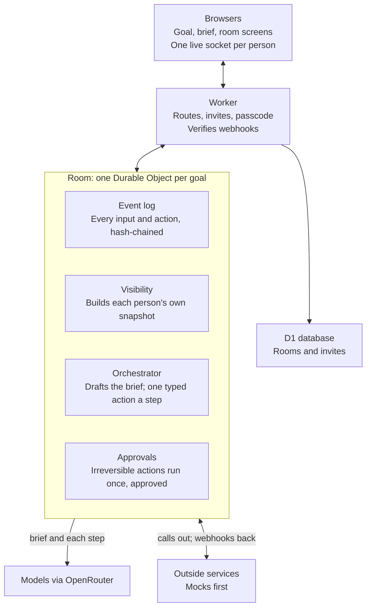

# Multiplayer Orchestrator: build plan

A room where several teams work toward one goal while a neutral AI orchestrator runs the process: it turns the goal into a brief, asks each team the right questions, compares options against agreed criteria, and only does anything irreversible after the named person approves.

This plan draws on a practice build done before the hackathon; tonight's code is written fresh.

## What we're building tonight

The smallest version that shows the idea end to end:

- A host types a goal; the AI drafts a brief of what the goal depends on, and the host commits what matters.
- Teams join by link and each sees only what's theirs.
- The orchestrator moves the room forward one typed action at a time: ask a team, propose options, call a vote, record a decision, request approval.
- Anything irreversible waits for the named decider's approval.
- Outside services (shops, calls, couriers, payments) start as mocks.

Stretch, if time allows: real outside services, and letting members bring their own AI agents over MCP.

## How it fits together

Stack: TypeScript on Cloudflare Workers with the Agents SDK (one Room per goal, with its own SQLite), D1 for rooms and invites, React and Vite for the screens, models through OpenRouter via the AI SDK.

## The user flow

1. **Goal.** The host types a title and a goal. Nothing else.
2. **Brief.** Agents draft what the goal depends on (deadline, budget, headcount, anything goal-specific) as ranked suggestions; the host commits the ones that matter and sets criteria, scope, risks, teams, who decides and how far the agent may go.
3. **Start.** Uncommitted suggestions are parked; teams and invite links are created.
4. **Room.** The orchestrator asks teams questions, proposes options scored against the criteria, calls votes, records decisions, and chases late answers.
5. **Approvals.** Calls, courier bookings and payments wait for the named decider, and run once.
6. **Done.** When every "done means" item is ticked, or the host finishes the room.

## Core concepts

| Term | What it is |
| --- | --- |
| Room | One goal, worked on by several teams; one Durable Object each. |
| Host | Whoever started the room. Admin controls, but sees only shared information. |
| Team, member, decider | Teams join by a shared link; each team's decider approves things for it. |
| Brief | The goal turned into parameters, criteria, done-means, scope, risks, rights and rhythm. |
| Parameter status | Suggested (from the AI), committed (enforced), or parked (kept, not enforced). |
| Scope | Who can see an event: shared, one team, or the platform only. |
| Event log | Every input and action, append-only and hash-chained. |
| Projection | What one viewer is sent, built from the log with the visibility rule. |
| Typed action | One of a fixed set of actions the orchestrator may return, checked in code before it runs. |
| Approval | The gate before anything irreversible; names the decider and runs the action once. |
| Adapter | The plug for an outside service, with mock, sandbox, live or manual modes. |

## Rules to hold from the start

- **One visibility rule.** Every event reaches a client through one check; a team's data never reaches another team, and the host gets no exception.
- **Model proposes, code decides.** The model returns one typed action; code checks budget, deadline, hard criteria, decision rights and open concerns before it runs.
- **Irreversible means approved, once.** The approval id makes a second run a no-op.
- **Agent text is data.** It can inform the orchestrator but never change the goal or anyone's rights.
- **No paid model calls without a passcode** on room creation, and tests never call a real model.

## Build order

| Step | Builds | Done when |
| --- | --- | --- |
| 0 | Scaffold: Worker, Room binding, D1, health check, deploy | Health check passes locally and deployed |
| 1 | Rooms and invites: create a room, signed invite links, WebSocket auth | A bad or other-room link is refused |
| 2 | Log and visibility: event log, scopes, per-viewer snapshots | A team event never reaches another team |
| 3 | Orchestrator on a scripted model: typed actions, step loop, approvals, concerns | Approving twice runs once; an open concern blocks approval |
| 4 | The brief: goal to suggested parameters, commit and park | A real model drafts a brief for two different goals |
| 5 | Mock adapters and one scenario end to end | The scenario finishes on mocks |
| 6 | Screens: goal, brief, room | Two people complete the flow by clicking |

## Who does what

| | Person A: server | Person B: screens and AI |
| --- | --- | --- |
| Steps | 0 to 3, then the adapters in 5 | The brief prompts in 4, the screens in 6, the demo scenario |
| Meet at | The message and snapshot types, agreed first | Same |

## Decisions already made

These came out of the practice run, so we don't need to rediscover them tonight:

- **Model output goes in the instructions, not strict structured output.** Anthropic's strict mode rejected our action schemas as too large; we send the JSON Schema in the prompt, validate with Zod, and retry once.
- **Approvals and decisions for one team's own choices stay with that team**, or the host and other teams see details they shouldn't.
- **Steps trigger when a question closes**, not on every answer, or a team of five triggers five model calls.
- **Team links are shared, so each browser sends a stable key**; otherwise every reconnect becomes a new member.
- **The brief is drafted in passes** (a quick first draft, then specialists, then a ranking) so the screen fills in within about 10 seconds instead of one long wait.
- **The host's export shows only what the host can see**, plus event hashes, so the log can be checked without exposing team data.

## Risks and open questions

- The full brief takes about 45 seconds; the first tiles need to appear fast.
- Lalamove has one sender and many recipients, so two pickups need a workaround.
- Mandarin speech recognition for shop calls is unproven.
- Whether members' own agents (Grok and others) can check in on a schedule over MCP.
