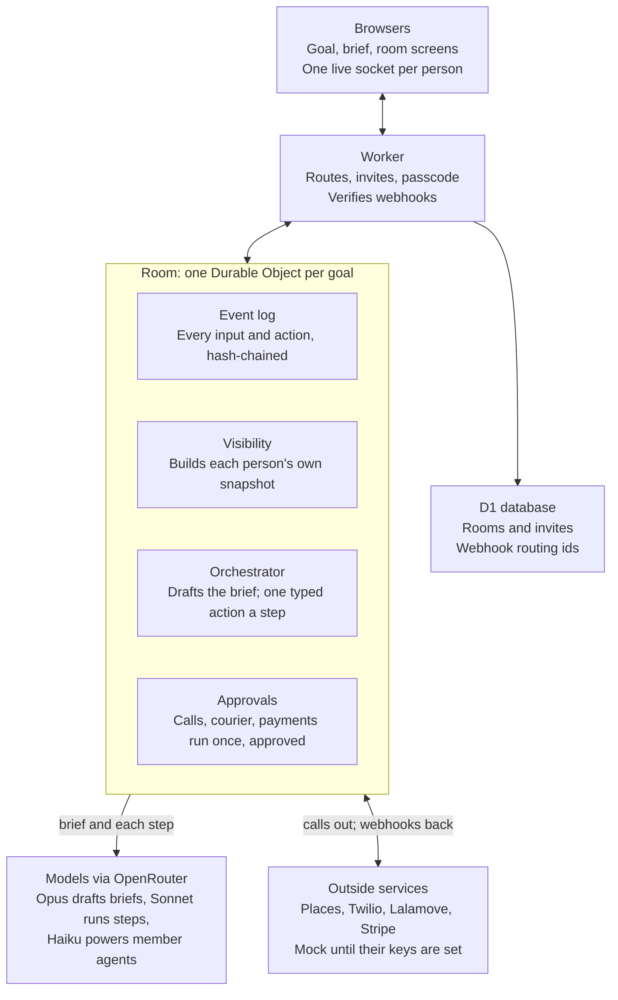

# Multiplayer Orchestrator handoff

Last updated 2026-11-11 · Jack A · [live, editable version](https://claude.ai/artifact/X1FywGKhbuHigqo95gq41G)

A room where several teams work toward one goal while a neutral AI orchestrator runs the process: it drafts a brief from the goal, asks each team the right questions, compares options against agreed criteria, and only does anything irreversible after the named person approves. It is live at https://multi.anandco.dev on real models.

This is a reference doc. The code it describes is not in this repo; paths like `src/room/` refer to that codebase.

## Status at a glance

The core runs for real: rooms, privacy, the hash-chained log, the orchestrator and the AI-drafted brief. The outside services (shops, calls, couriers, payments) run on mocks; their real versions are written but untested.

| Part | State | How we know |
| --- | --- | --- |
| Rooms, invites, WebSocket sync | Live | Integration tests; live smoke check |
| Team privacy and the host's "bank" view | Live | Isolation tests; scenario test checks the host never sees team data |
| Hash-chained event log | Live | Unit and integration tests; `GET /verify` on the live site |
| AI brief (framer, 3 specialists, conductor) | Live, real models | Real runs via OpenRouter, ~45 s per brief |
| Orchestrator steps | Live, real models | Real call ~3.4 s; scripted in tests |
| Members' own agents (built-in) | Live, real models | Integration tests; not yet tried by real users |
| Passcode for creating rooms | Live | Unit tests; live 401 without it |
| Shop search, calls, courier, payments | Mock | Contract tests on mocks |
| Google Places, Twilio, Lalamove, Stripe | Written, untested | No keys set yet; sandbox contract tests ready |
| Connect your own agent (MCP) | Planned | PRD and contract in the code; tests are todos |

Tests: 111 unit, 38 integration, 7 contract, 1 end-to-end scenario and 2 browser flows pass.

## How it works

Browsers and webhooks reach a room only through the Worker. The room alone decides what each person sees, asks the models for one action at a time, and calls outside services only after an approval.

## The user flow

Three screens: goal, brief, room. The first and last are generic; the brief is where the AI does most of its work.

1. **Goal.** The host types a title and a goal, and the passcode if the server asks for one. Nothing else.
2. **Brief.** Agents draft what this goal depends on. Parameters (deadline, budget, headcount, anything goal-specific) arrive as suggestions ranked by importance; the host commits the ones that matter. The host also sets the criteria, what's out of scope, milestones, risks, teams, who decides, how far the agent may go, and the check-in rhythm, all by clicking. Undo works on every change.
3. **Start.** Uncommitted suggestions are parked, teams and invite links are created, and only the host sees the links.
4. **Room.** Members join by link. The orchestrator asks each team questions, proposes options scored against the criteria, calls votes, and records decisions. It chases late answers and escalates to the decider after two reminders.
5. **Approvals.** Anything irreversible (a phone call, a courier booking, payments) waits for the named decider to approve, and runs once.
6. **Done.** The room finishes when every "done means" item is ticked and nothing outside is still pending, or when the host clicks Finish.

## Core concepts

| Term | What it is |
| --- | --- |
| Room | One goal, worked on by several teams. Each room is its own Cloudflare Durable Object with its own database. |
| Host | Whoever started the room. Has admin controls but sees only shared information, like any guest. |
| Team, member, decider | Teams join by a shared link; each team has one decider (their own link) who approves things for that team. |
| Brief | The goal turned into parameters, criteria, done-means, scope, milestones, risks, rights and rhythm. |
| Parameter status | Suggested (from the AI), committed (enforced), or parked (kept for later, not enforced). |
| Scope | Who can see an event: shared (everyone), team (one team), or record (the platform only). |
| Event log | Every input and action, append-only, each event hashed with the one before it so edits are detectable. |
| Projection | What one viewer is sent: built from the log with the visibility rule, never the raw data. |
| Orchestrator step | Read the room, ask the model for exactly one typed action, check it in code, run it, log it. |
| Typed action | One of 13 actions, such as ask a team, propose options, call a vote, request approval, or wait. |
| Approval | The gate before anything irreversible; it names the decider and runs the action once. |
| Adapter | The plug for an outside service, with a mock, sandbox, live or manual mode. |
| Member agent | A built-in AI assistant for each member: sees their team's context, drafts answers, shares only what they confirm. |

## Rules that must not break

These hold whatever the UI becomes; each has tests.

- **One visibility rule.** Every event reaches a client only through `canSee`. A team-scoped event never reaches another team's screen, and the host has no exception.
- **The bank model.** The platform holds everything; the host's export gets only what the host could see, plus every event's hash, so the log can be verified without revealing team data.
- **Model proposes, code decides.** The orchestrator returns one typed action; code checks it against the budget, deadline, hard criteria, decision rights and open concerns before anything runs. Invalid output is retried once, then escalated.
- **Irreversible means approved, once.** Calls, courier bookings and payments only run after the named decider approves, and the approval id makes a second run a no-op.
- **Agent text is data.** What members' agents write can inform the orchestrator; it can't change the goal or anyone's rights.
- **No paid calls without a passcode.** With live models on and no passcode set, the site refuses to create rooms. Tests never call a real model.

## What to keep if you change the UI

If you drop the dashboard and the floating brief, almost all the value is still there: the screens are a thin layer over a room that already speaks a typed protocol.

| Keep as is | Replaceable |
| --- | --- |
| The room, invites, log, privacy and projections (`src/room`, `src/auth`) | The dashboard tiles and layout (`web/Room.tsx`, `web/components/*`) |
| The orchestrator, actions, scoring, approvals (`src/orchestrator`) | The floating, ranked brief canvas (`web/Shaping.tsx`, `useFlip`) |
| The brief's data model and click edits (`src/shared/plan.ts`) | The start page (`web/CreateRoom.tsx`) |
| The planner passes, even without the live float (`src/orchestrator/planner.ts`) | Styling (`web/styles.css`) |
| Adapters and webhooks (`src/adapters`, `src/webhooks.ts`, `src/voice.ts`) | |

Any new front end, including a chat-only one or an outside agent over MCP, talks to the same two things: the snapshot it receives (`src/shared/projection.ts`) and the messages it sends (`ClientMessage` in `src/shared/schemas.ts`). The planner can also return its final brief in one go if nothing needs to render it live.

## Code map

TypeScript end to end, about 8,000 lines, on Cloudflare Workers with the Agents SDK, React and Vite.

| Path | What's there |
| --- | --- |
| `src/worker.ts` | HTTP routes: create room, invites, verify, export, health, webhooks, operator checks |
| `src/room/` | The Room object: connect and auth, inputs, the event log and scopes, projections, check-ins, notifications |
| `src/orchestrator/` | The step loop, the 13 typed actions and their handlers, scoring, approvals, the planner passes, prompts |
| `src/shared/` | Types shared with the web app: domain types, the brief, projections, client messages, the agent contract |
| `src/adapters/` | Models (OpenRouter, Anthropic, OpenAI, Google), mocks, and the real Places, Twilio, Lalamove and Stripe adapters |
| `src/members/agent.ts` | The built-in member agents |
| `src/auth/` | Signed invite tokens; the room passcode |
| `src/webhooks.ts`, `src/voice.ts`, `src/ops.ts` | Stripe and Lalamove webhooks; Twilio call callbacks; operator pipe checks |
| `web/` | The React app: start page, brief canvas, room dashboard, components |
| `test/` | Unit, integration (real Room in workerd), contract, scenario, Playwright |
| `scripts/smoke.ts` | One line per pipe against a deployed Worker |
| `migrations/` | The global D1 tables (rooms, invites, external references) |

## Run, test and deploy

Local secrets go in `.dev.vars` (copy `.dev.vars.example`); it's git-ignored, and tests ignore it.

| Command | Does |
| --- | --- |
| `npm run dev` | Local app at http://localhost:5173, live models if `.dev.vars` says so |
| `npm test` | Unit tests |
| `npm run test:int` | Integration tests against a real Room |
| `npm run test:scenario` | The full food-run scenario on mocks, under 1 second |
| `npm run test:e2e` | Playwright browser flows, always on the scripted model |
| `SANDBOX=1 npm run test:contract` | Real-service checks: one real brief, one real step, plus any service with keys |
| `npm run deploy` | Build and deploy to Cloudflare |
| `npm run smoke -- --url https://multi.anandco.dev` | Checks every pipe on the live site |

On Cloudflare: secrets `INVITE_SIGNING_SECRET`, `OPERATOR_SECRET`, `ROOM_PASSCODE`, `OPENROUTER_API_KEY` are set. Settings in `wrangler.jsonc` choose each adapter's mode and the models: `PLANNER_MODEL` (Opus 5.5), `PLANNER_FAST_MODEL` and `ORCHESTRATOR_MODEL` (Sonnet 5.5), `PLATFORM_MODEL` (Haiku 5.5), all as `openrouter:<model>`.

Cost: about $0.15 per brief plus a few cents per orchestrator step; each room is capped at 200 steps.

## Known gaps and next steps

- [ ] Decide where the code lives; it isn't in this repo.
- [ ] Build Connect your agent (MCP), split into two tracks in its own PRD.
- [ ] Add keys and run the real Places, Twilio, Lalamove and Stripe adapters (`SANDBOX=1 npm run test:contract`).
- [ ] Test Lalamove's two-pickup workaround with a real driver; Lalamove has one sender and many recipients, not several pickups.
- [ ] Try Twilio's Mandarin speech settings on a real call; replying to a shop is classified by keywords, which is crude.
- [ ] Look up coordinates for a typed location; today it falls back to central Taipei.
- [ ] Shorten the 45-second brief, or keep showing tiles as they arrive.
- [ ] Decide whether the orchestrator's 2-second step spacing and 200-step cap fit real rooms.
- [ ] Nobody has used it with real teams yet; a run with friends will find what tests can't.

## Key documents

| Document | Read it for |
| --- | --- |
| `SPEC_NOTES.md` (code repo root) | Every gap in the original spec and how it was filled; answers to the spec's open questions; what each real test run showed |
| `AGENTS.md` (code repo root) | Commands and the rules any coding agent must follow in that repo |
| `Multiplayer Orchestrator — Build Spec.pdf` (code repo root) | The original spec this was built from |
| [Connect your agent](https://claude.ai/artifact/93KLZw21VJPh4hMkhvzW6e) | The PRD for members' own agents over MCP, split into two tracks |
| `src/shared/agentApi.ts` (code repo) | That feature's contract, in code |
